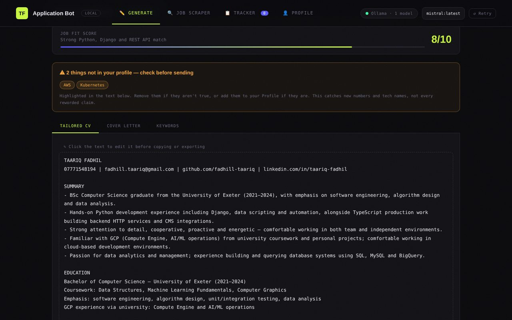
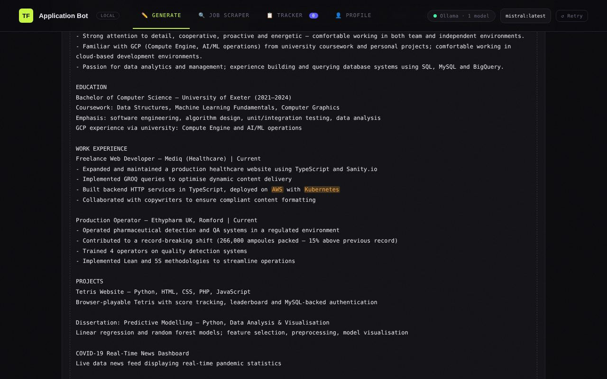
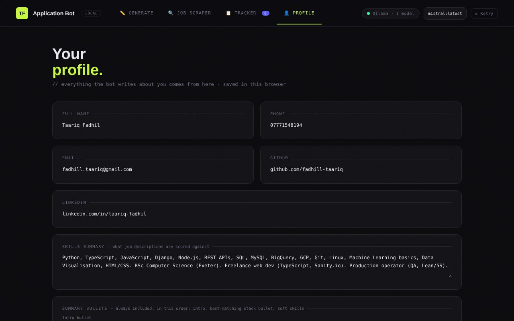
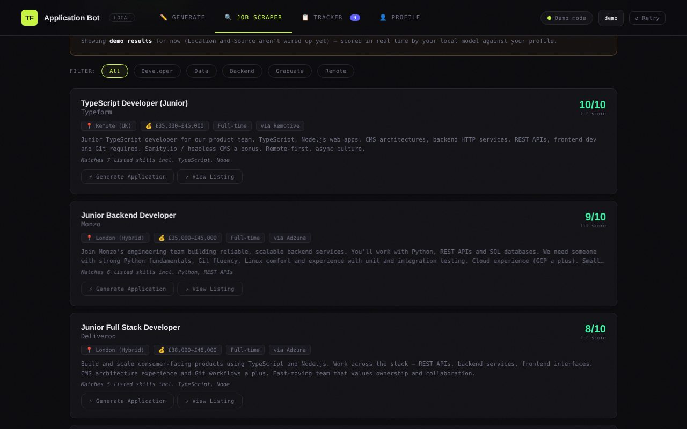

# Job Application Bot

A local job application assistant powered by [Ollama](https://ollama.com) LLMs. It generates a tailored CV and cover letter from any job description, scores your fit, checks the output for claims that aren't in your profile, exports to PDF and tracks every application. Everything runs 100% locally, with no API key required.

**▶ [Try the live demo](https://fadhill-taariq.github.io/job-application-bot/)**: runs in demo mode in the browser, no install needed.



## Features

### Generate Tab
- **Tailored CV**: a keyword-driven summary plus an LLM rewrite that mirrors the job description's priorities
- **Cover letter**: fills in and tailors your own cover letter template for the role and company
- **Job fit score**: rates your match 1–10 with a brief explanation
- **Fact check**: flags any number, technology or unfilled blank in the output that isn't in your profile, highlighted in the text, so a model "improvement" never makes it into an application
- **Edit before export**: the CV and cover letter are editable in place; copy and PDF export use your edited text
- **PDF export**: the CV in a clean two-column Canva-style layout (with a warning if it overflows one page); the cover letter as a formatted A4 document
- **Log as Applied**: sends the application straight to the tracker



### Profile Tab
- **One source of truth**: name, contact details, the skills used for scoring, summary bullet rules, CV body and cover letter template all live in one profile
- **Import a CV**: upload a PDF, Word (.docx) or text CV; it's read in the browser, rearranged into the profile format (by the local model, or simple rules without Ollama), checked against the original for anything added or dropped, and loaded into the form for review
- Edit everything in the browser (saved in `localStorage`), or change the defaults in [`js/profile.js`](js/profile.js)
- Export / import the profile as JSON for backups or another machine
- Tailoring rules (stack variants, cloud bullet, conditional bullets) are editable as JSON, with whole-word tag matching



### Job Scraper Tab
- **Live jobs** from Google for Jobs (LinkedIn, Indeed, Glassdoor, company sites) via the [JSearch API](https://rapidapi.com/letscrape-6bRBa3QguO5/api/jsearch), searchable by keywords, location, country and posting date
- Every result scored against your profile by your local model
- Without a key, falls back to built-in demo listings
- Filter by role type (Developer, Data, Backend, Graduate, Remote)
- Minimum fit score threshold slider
- One-click to load any listing into the Generate tab



### Tracker Tab
- Logs every application you submit with role, company, fit score, date and status
- Stats dashboard: total applied, average fit score, this week's count, top role type
- Persists across sessions via `localStorage`
- Remove individual entries

## Quick Setup

**1. Install Ollama**

- **Windows / Mac:** download the installer from [ollama.com/download](https://ollama.com/download)
- **Linux:**
  ```bash
  curl -fsSL https://ollama.com/install.sh | sh
  ```

**2. Pull a model** (pick one)
```bash
ollama pull llama3      # 4.7 GB — best quality
ollama pull mistral     # 4.1 GB — fast & reliable
ollama pull phi3        # 2.3 GB — lightweight
```

**3. Start Ollama with browser access (CORS)**

Windows (PowerShell):
```powershell
$env:OLLAMA_ORIGINS="*"; ollama serve
```

Mac / Linux:
```bash
OLLAMA_ORIGINS="*" ollama serve
```

If you get "address already in use", Ollama is already running in the background. Quit it from the system tray / menu bar and run the command again. Keep this window open while using the app.

**4. Open the app**

Extract the zip (or clone the repo), then open `index.html` in your browser. There's no build step and no server needed.

**5. (Optional) Live job search**

Get a free JSearch key: open [JSearch on RapidAPI](https://rapidapi.com/letscrape-6bRBa3QguO5/api/jsearch), subscribe to the **Basic** plan ($0, 200 searches a month) and copy `X-RapidAPI-Key` from the Endpoints tab. Paste it into **Profile → Live job search key**. The key is stored only in your browser; it isn't part of the profile export and never goes into the code.

**6. Set up your profile**

Open the **Profile** tab and click **Upload CV** to import your CV, or replace the details by hand: contact info, skills summary, CV body and cover letter template. Review the boxes, then click **Save Profile**.

## Demo Mode

Without Ollama, the app can run in demo mode: add `?demo` to the URL, click **Try demo mode instead** in the setup box, or open the hosted version (it switches automatically when no local model answers). The CV summary still uses the real keyword rules; the fit score and cover letter use simple deterministic stand-ins instead of an LLM.

## How It Works

The app makes three focused Ollama API calls per generation:

| Call | Task | Output |
|------|------|--------|
| 1 | Score job fit + extract keywords | JSON: score, reason, keywords |
| 2 | Rewrite CV to match JD | Plain text tailored CV |
| 3 | Tailor cover letter template | Plain text cover letter |

Each call is small and focused, so local models handle them reliably. The results are then fact-checked against your profile: any number, technology or tool in the output that doesn't appear in your profile is flagged for review.

## Tech Stack

- Vanilla HTML / CSS / JavaScript: zero dependencies, zero build tooling
- [Ollama](https://ollama.com): local LLM inference (llama3, mistral, phi3, etc.)
- [jsPDF](https://cdnjs.cloudflare.com/ajax/libs/jspdf/2.5.1/jspdf.umd.min.js): client-side PDF generation
- [pdf.js](https://mozilla.github.io/pdf.js/) and [mammoth.js](https://github.com/mwilliamson/mammoth.js): reading uploaded PDF and Word CVs (loaded only when you import one)
- `localStorage`: profile and application tracker persistence

## File Structure

```
index.html          # Page markup — open this in your browser
css/styles.css      # Styles
js/profile.js       # Default profile + summary tailoring rules + CV builder
js/factcheck.js     # Flags output that isn't supported by the profile
js/demo.js          # Demo mode (no Ollama needed)
js/cvimport.js      # CV upload: PDF/Word text extraction and conversion
js/jobsearch.js     # Live job search (JSearch API)
js/app.js           # Generation, PDF export, scraper, tracker, Profile tab
docs/               # README screenshots
```

## Notes

- Demo job listings are included for testing without a live job API
- JSearch coverage varies by country, as it depends on what Google for Jobs indexes there
- The fact check catches new numbers and technology names, not every reworded claim, so always read the output before sending
